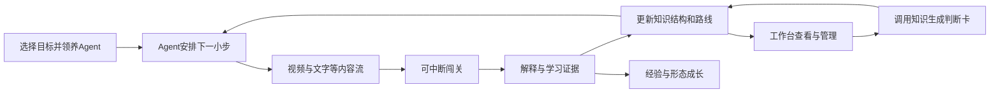

# AI学习搭子产品需求

版本：0.3，待审阅。日期：2026年10月12日。适用范围：腾讯视频AI产品经理实战题的首版产品开发。此版明确多形式内容流、个性化重点标记、有依据的记忆更新、精确引用定位和产品设计难点。

用户拥有一个可养成的Personal Learning Agent，在聚合短视频、文字解释、策展信息和互动任务的内容流中学习AI知识。Agent根据目标与学习记录筛选内容、标记重点、连接知识、保存记忆与调整路线；用户通过可中断的小关卡检验理解，通过工作台查看、管理和应用积累。关键观点可追溯到原始资料的具体位置。

本版明确可开发的功能、规则、内容样例与验收条件。用户需求强度、学习效果和差异化仍需验证；文中的目标值是设计与验收目标，不是已取得的结果。功能实现情况以研发交付与实际验收为准。

## 一 产品目标与约束

### 用户价值

帮助AI产品经理在有限时间内获取值得学的内容，逐步形成能够解释、连接、应用和更新的知识体系。用户主要负责学习与反馈，Agent承担组织工作。

### 题目约束与设计选择

| 项目 | 要求或选择 | 设计影响 |
| --- | --- | --- |
| 学习时间 | 题面为每周约3小时，其中一半碎片时间；按本次讨论，将全部学习设计为可碎片完成 | 不要求集中学习、长作业或固定每日时段 |
| 使用场景 | 排队、等车等不可预测的小空档 | 可随时暂停、离开和接续；每一步提供小收益 |
| 核心目标 | 逐步建立体系化AI知识 | 视频、关卡、知识关系、应用记录使用同一套知识标识 |
| 吸引与留存 | 有趣、生动、有挑战、有成长感 | 趣味内容负责打开动力，挑战与养成提供反馈，连续积累支撑复用 |
| 作答交付 | 两小时内做出实际可用产品 | 首版控制内容规模，完成真实播放、作答、保存、整理和应用闭环 |
| 演示 | 答辩演示与QA共20分钟 | 能演示首次使用、中断恢复、路线变化、形态解锁、工作台和应用输出 |

产品不以观看时长最大化为目标。每周180分钟是默认投入预算，包含观看、闯关、回顾、对话和站内应用；时间只做估算，不宣称精确测量学习投入。

## 二 用户与需求分析

按用户在某个主题的学习状态划分，允许同一用户在不同主题采用不同路线。

| 用户状态 | 典型任务 | 核心需求 | 路线重点 |
| --- | --- | --- | --- |
| 入门或转型 | 建立AI产品基础 | 学习顺序清楚，概念容易理解 | 基础类比、前置概念、低门槛判断 |
| 已承担AI任务但知识零散 | 设计方案、参与评审 | 补齐缺口，理解关系，形成工作判断 | 情境切入、关系辨析、应用练习 |
| 已有较完整框架 | 评估新方法、新能力 | 将变化接入已有知识，检验影响 | 直接挑战、边界条件、证据与更新 |

### 核心痛点与机制

| 痛点假设 | 用户损失 | 产品机制 |
| --- | --- | --- |
| 不知道什么值得学 | 筛选和重复阅读消耗时间 | 按目标、前置知识、可靠性、投入筛选 |
| 知识零散，概念联系不清 | 信息增加，判断能力难以积累 | Agent维护知识结构，为内容提供关系解释 |
| 看过但无法确认理解 | 错误认识持续存在 | 短关卡、解释反馈、不同情境复核 |
| 经常被打断 | 重新找内容、回忆上下文 | 自动保存、一句话接续、有限学习队列 |
| 学习收益难以感知 | 缺少再次打开的理由 | 形态成长、学习证据、可使用的判断卡 |
| 阅读负担大，不知道哪里与自己有关 | 在长资料中寻找重点，容易遗漏条件 | 个性化段落或时间段标记，说明理由并保留上下文 |
| 内容与Agent判断难以核查 | 无法确认信息是否被误解、推断是否过强 | 观点定位到原文，学习判断定位到具体行为证据 |
| 学习过程缺少兴趣和挑战 | 想学习却难以持续进入 | 趣味内容、适配难度的小挑战和可养成搭子 |

第一轮验证优先观察有实际任务但知识零散的用户，同时保留另外两种路线。不能把自选路线直接视为能力评估结果。

## 三 产品定位与首版范围

产品主张：养一个专属AI学习搭子，在零散时间里一起探索、闯关和应用知识；由它把每次发现整理成个人知识体系。

首版采用移动端优先的网页产品，兼容桌面演示。默认访客使用，无需注册。持续进展保存在当前浏览器；跨设备同步为后续能力，产品必须说明当前保存范围。

| 模块 | P0 首版必须实现 | P1 后续扩展 |
| --- | --- | --- |
| 学习Agent | 领养、命名、常驻形象、点击交互、上下文帮助、四阶段形态 | 语音交流、更多角色与高级动画 |
| 内容流 | 一个主题、三段趣味短视频、三篇微讲解、一张策展信息卡；来源、内容类型、预计投入和接续入口 | 更多主题、外部内容接入、规模化生产与自动采集 |
| 个性化重点 | 从审核标记中按目标、缺口、前置关系选择段落或时间段，展示理由、关闭与反馈 | 模型辅助发现新的重点片段并核对 |
| 引用核查 | 观点绑定原始片段、位置与版本；来源面板高亮、上下文、完整原文入口 | 更广泛的原文定位适配 |
| 闯关 | 三章节、六个练习、六个章节检查题、提示与解释、真实计分 | 开放回答、多模态实验、更多变式 |
| 体系化 | 八个知识节点、关系、知识卡、证据记录、更新历史与路线调整 | 更大知识网络、跨主题关联 |
| 工作台 | 今日队列、知识地图、进展、记忆管理、应用成果、养成查看 | 多项目空间、协作与跨设备同步 |
| 学以致用 | 一个实际工作场景、方案判断卡生成、编辑、保存、导出 | 更多工作模板、项目资料接入 |
| 内容更新 | 来源库、策展更新卡、影响节点标注 | 自动发现资讯、内容审核工作台 |

首版不实现社交合养、排行榜、商城和无限资讯流。原题“形态不限”并不要求接入腾讯视频账号。真实视频资产、完整核心路径、持久化和知识应用属于交付条件。

## 四 信息架构与主路径

底部导航为“学习”“工作台”“搭子”。学习页直接提供内容入口；工作台集中管理；搭子页查看养成、记忆及交流偏好。Agent在视频和关卡页以小型入口出现，不遮挡内容。

视频可以直接观看；题目和检查点也可以直接尝试。Agent提供顺序建议，基础内容保持可访问。成长奖励可通过挑战解锁。

## 五 页面与功能要求

### 首次进入

1. 首屏同时显示产品价值、Agent预览和“先体验”按钮。未领养也能开始第一条内容。
2. 用户选择目标：“建立基础”“解决工作问题”“更新已有认识”。可跳过，默认建立基础。
3. 领养默认角色，可改名；交流偏好默认为“简洁友好”，可选“直接清楚”。选择过程随时可结束。
4. Agent给出首个任务及一句推荐理由。诊断通过后续自然作答逐步完成，首次进入不设置长测试。

验收：只点“先体验”即可播放内容；完成或跳过设置后均有明确下一步；刷新保留已确认设置。

### 学习首页

首屏包含Agent、一句话接续、当前推荐和预计投入。推荐优先级为“未完成任务”“近期暴露的关键缺口”“当前目标下一步”“相关更新或回顾”。同一优先级按路线顺序稳定排序。

每次展示最多三个任务，类型可为视频、练习、回顾或应用。更多内容通过工作台访问。用户可选择“换一个”“稍后”“直接挑战”，并查看推荐理由。

“今日”指当前日期下的可用建议，不是每日作业。以Asia/Shanghai计算日期；次日不堆叠欠账，未完成进展由Agent重新安排。

### 多形式内容流与重点标记

内容流包含视频、微讲解、策展信息卡和互动任务。卡片显示内容类型、来源、相关知识、预计投入、推荐理由和继续位置。用户可按类型筛选，切换表达方式；同一知识单元的文字与视频共享关系和来源，不把切换媒介当作重复掌握。

首版三篇微讲解分别对应三个视频的学习目标，复用已核对的知识、例子和题目。一张策展信息卡展示一项值得关注的判断及其依据，注明策展属性与原始资料日期；如果没有真实新变化，不呈现为最新新闻。后续资讯可以引出前置学习，也可以直接连接已学知识。

内容编辑为段落或视频时间段配置nodeIds、前置要求、适用目标、关键陈述和claimIds。Agent从这些审核片段中自动选择对当前用户重要的部分，依据为“任务相关”“补充缺口”“更新认识”。没有足够个人证据时展示通用重点，不假装了解用户能力。

文字使用段落级强调，视频在时间轴与字幕旁标记重点，可点击查看或跳至相关段落。重点默认少量展示，用户可关闭、展开上下文、查看原因，反馈“与我无关”“已知道”“太难”。推荐重点与证据原文的高亮分别标明：前者解释为何值得关注，后者展示事实依据。

用户的内容偏好影响表达方式；知识状态影响深度和前置安排，不按高级用户只读论文、入门用户只看视频固定分配。普通阅读无需先答题；挑战作为独立入口，内容和挑战之间可以跨次接续。

### 短视频学习页

必须支持真实视频播放、暂停、拖动、字幕开关、静音、重播、出处查看和继续上次位置。默认静音并显示字幕，用户明确播放后开始；首版建议视频长45至75秒，段落有时间标记，解释可逐步展开。

播放进度每2秒保存一次，并在暂停、离开和页面隐藏时保存。浏览器隐藏后暂停播放。返回提供“从上次继续”和“从头看”。恢复误差目标不超过3秒。

观看覆盖率由实际播放过的时间区间合并计算，拖动到结尾不算完整观看。覆盖至少80%可记为“已接触”，不代表理解。缺失或加载失败显示重试与完整图文解释；图文阅读单独记录，不能伪造视频播放完成。

视频结束展示一句发现、下一小步和可选挑战。Agent对话不会自动暂停之外改变播放进度；打开帮助时暂停，关闭后由用户继续。

### 闯关页

每题一个核心判断，使用单选或简单情境选择。首版标准答案、解释、误解标签和知识关系均由内容配置提供。选中答案后用户点提交；提交前可离开，返回恢复选择。

提交结果包含：本题结论、为什么、错误选项的问题、关联知识、下一步。答错不扣经验，可查看提示、回看对应片段或再试。提示后的正确回答记为“有引导的练习”；无提示且未看过本题答案的正确回答记为“独立答题记录”。

每章两个练习和两个检查题。两个检查题均正确可完成该章节，不要求先看完视频。有提示仍可完成关卡，但证据强度如实记录。重复同题只表示复习；后续变式与隔段时间复核才补充新的应用证据。

题目完成和知识状态更新必须保存成功后再展示奖励。提交按钮防重复；同一关卡不能重复领奖。切换路线、刷新或重放庆祝动画不产生新的经验。

## 六 Agent形态与交互

### 视觉角色

角色采用原创知识精灵：圆润主体、清楚的表情、发光知识节点，适合成人产品经理。角色在小尺寸下仍可识别。背景、装扮和动画逐步丰富；变化附带本次学习记录说明。

基础情绪状态为待机、好奇、思考、庆祝、休息。用户离开后进入休息状态，回来时正常接续。思考动画仅对应真实待处理任务；自动整理成功后才显示完成反馈。支持减少动画。

### 交互入口

| 入口 | 用户动作 | Agent行为 |
| --- | --- | --- |
| 首页角色 | 轻点 | 打开底部面板，提供“继续上次”“为什么推荐”“看我的积累” |
| 视频旁角色 | 轻点 | 基于当前段落提供“换个例子”“解释这个词”“它和之前有什么关系” |
| 关卡旁角色 | 轻点 | 提供一层提示；用户确认查看后记录提示使用，不直接提前泄露答案 |
| 自由提问 | 输入简短问题 | 引用可用知识与来源回答；必要时说明信息不足 |
| 工作台关系或证据 | 点击 | 解释关系、展示依据和相关学习入口 |
| 应用卡 | 点击“帮我检查” | 根据场景、缺失项和知识关系提供检查建议 |

不以无关养宠操作占用学习时间。命名、换装、互动可以提供情绪反馈，但不要求投喂或日常维护。

### 对话呈现

每次回答先给一小段主要解释，更多内容由“展开”呈现。回答包含可点击的知识点和可用来源。用户可以反馈“不准确”“太难”“换个例子”。Agent据此修改表达或推荐；一次反馈不自动推断完整能力。

未接入生成模型时，上下文帮助使用经过审核的解释、提示和FAQ，界面说明当前帮助范围；不能伪装为已完成实时模型调用。开放问题超出首版内容库时说明范围并保留问题，不生成无依据事实。

### 养成规则

| 奖励或阶段 | 首版规则 | 呈现 |
| --- | --- | --- |
| 练习经验 | 六个练习首次通过各20经验 | 简短庆祝与本次发现 |
| 检查题经验 | 六个检查题首次通过各40经验 | 章节进展与相关知识 |
| 等级1 | 初始 | 基础精灵 |
| 等级2 | 至少80经验，且完成任意一个章节 | 解锁观察员形态 |
| 等级3 | 至少160经验，且完成任意两个章节 | 解锁连接者形态 |
| 等级4 | 至少240经验，且完成三个章节 | 解锁探索者形态 |

经验最大基础值为360。经验记录学习历程，等级与形态不代表专业资格或完整掌握。观看、发消息、反复点击角色不产生经验。高级用户可直接完成检查题，获得相应经验与形态。

各形态从解锁后进入外观库，可自由切回旧形态。对话、记忆、整理与基础学习能力从首次使用起可用。未学习不会掉级，已取得成果保留。

| 形态 | 可识别外观变化 | 对应反馈 |
| --- | --- | --- |
| 基础精灵 | 圆润小光团、清楚的眼睛和一枚知识光点 | 第一次探索与接续学习 |
| 观察员 | 增加放大镜造型的配件、清楚的侧边光环 | 展示第一次章节完成记录 |
| 连接者 | 两至三枚环绕知识节点，节点间有连线 | 展示已经建立的知识关系 |
| 探索者 | 完整环绕星轨和可展开的知识徽章 | 展示跨章节积累和应用入口 |

形态变化至少包含轮廓或配件变化，不能只改颜色。庆祝结束后回到正常待机，知识徽章可点击查看真实记录。用户减少动画时仍能看到阶段说明与新外观。

## 七 Agent记忆与管理

### 记忆结构

| 记忆类别 | 保存内容 | 更新依据 | 用户管理入口 |
| --- | --- | --- | --- |
| 目标与偏好 | 学习目标、当前问题、交流风格、时间预算 | 用户明确选择或修改 | 工作台的目标与偏好 |
| 任务进展 | 视频位置、答题草稿、未完成步骤、最近一次学习 | 实际操作记录 | 今日队列与继续学习 |
| 理解证据 | 对应题目、答案、提示使用、误解、应用记录和日期 | 作答与应用行为 | 知识点详情 |
| 学习路线 | 下一步、安排理由、待复习项、用户跳过项 | 有约束的规划规则 | 路线查看与调整 |

个人记忆与领域知识库分别保存。用户聊天中的事实陈述不会直接修改领域知识；“我懂这个”作为自述保存，不能替代验证记录。

### 记忆管理功能

用户可查看Agent记得什么、从哪里得出、最后更新时间；能修改明确偏好、删除对话、移除记忆条目、暂停某类偏好记录。删除原始学习记录时同步删除依赖它的证据，再重算个人视图，避免留下无来源的理解标签。

删除一条偏好后重新安排未来任务；删除答题证据后撤回由该证据支持的标签。已取得的形态和经验保留，奖励账本只保留必要的领取与去重记录，防止删除证据后再次领取同题经验。执行“清除全部学习数据”则同时重置学习、记忆和养成记录。

最近对话原文最多保留20轮供上下文使用，长期只保存用户确认的偏好与结构化学习记录。超过20轮保留结构化摘要，不伪造逐字记忆。完整历史是否保留由后续同步方案决定。

自述与证据冲突时并列呈现：“你认为已理解；当前记录显示这个情境仍需复核。”用户可修正评估，修正记录有来源并可撤销；不会悄悄删除历史或自动补发奖励。

### 更新验证与历史

更新区分客观记录、理解推断与领域知识。客观记录来自产品事件；理解推断必须绑定题目、情境和提示条件；领域知识由公共内容核对流程发布，个人对话不能直接覆盖。

Agent先提出结构化修改，包含对象、原状态、拟更新状态、依据标识、适用范围、触发原因与时间。程序检查事件和引用是否存在、题目判定与提示条件是否一致、规则是否合法，再写入个人视图。对开放解释的模型判断标为待验证，不能仅凭模型自评提升理解状态。

验证失败保留原状态与待核对项，不静默覆盖。成功更新保留前后版本，用户可查看和撤回；撤回同时重算后续路线与可视化状态。具体观看、作答和应用事件保留自身来源，摘要中的重要结论能回查原记录，避免只凭旧摘要反复归纳。

理解判断限定于对应情境。一次独立答对增加一条证据，多次不同情境复核才增加支持范围；提示后答对、重复同题和用户自述单独标记。用户反馈可以纠正Agent判断，但不修改审核过的领域事实。

首版提供学习数据导出及清除入口。清除前说明影响并由用户执行；当前浏览器清理、换设备导致丢失的边界在管理页明确说明。

## 八 知识结构与自动整理

### 领域骨架

首版主题为“AI问答产品怎样形成可信判断”。八个知识节点如下，范围可逐步扩展。

| 节点 | 名称 | 学习目的 |
| --- | --- | --- |
| K01 | 表达流畅与信息可靠 | 区分表达质量与可靠性判断 |
| K02 | 回答与依据 | 检查结论是否被给定材料支持 |
| K03 | 不确定性与信息不足 | 识别材料不足时应如何表达 |
| K04 | 检索增强的基本流程 | 理解检索、材料提供和生成之间的关系 |
| K05 | 检索结果与生成使用 | 区分找到资料与正确使用资料 |
| K06 | 失败环节定位 | 判断优先检查检索还是生成 |
| K07 | 评估维度 | 区分依据一致性、外部事实验证和任务适用性 |
| K08 | 证据与认识更新 | 在材料或条件改变后重新检查判断 |

关系由编辑提供并附解释：K01关联K02，K02连接K03；K04包含检索与生成环节，连接K05；K05是分析K06的基础；K02和K06连接K07；K07连接K08。前置关系不得形成环，模型不能直接新增未审核的领域关系。

### 个人知识状态

默认状态依次为“未接触”“已接触”“有理解练习记录”“有应用尝试或练习记录”。每个状态显示具体证据和条件，额外标记“有引导”“独立尝试”“自述”“需复核”。工作卡为应用尝试，标准化应用题为应用练习；两类依据分别展示。

状态表示当前内容范围内的记录，不把一道题当作一般能力证明。后来答错保留历史证据，并添加待复核标记；后续复核通过可清除该标记。观看和经验不会直接提升理解状态。

### 自动整理触发

视频有效接触、题目提交、应用卡保存、目标修改、来源更新均触发整理。处理顺序为：保存事件、更新证据、更新个人视图、调整路线、记录解释、呈现反馈。重复事件必须幂等。

整理记录示例：“已把本次材料检查练习连接到‘回答与依据’，依据是Q03独立作答。下一步建议理解‘信息不足’，因为你在Q02选择了直接承诺。”两条结果分别来自相应事件，不能由同一次答题同时推断互相矛盾的结果。

整理视图分为知识地图、个人知识卡、成长轨迹。地图展示模块与关系；知识卡展示解释、来源、证据、误解与应用尝试；轨迹展示建立了哪些关系、修正了哪些认识和完成了哪些尝试。地图节点变化必须能下钻到具体依据，不用游戏等级代替知识状态。

整理发生在已保存的事件之后。界面不显示虚构的整理进度，不声称Agent已掌握用户的一切。

## 九 差异化路线与时间安排

| 起始目标 | 初始推荐 | 后续调整 |
| --- | --- | --- |
| 建立基础 | V01及相关练习 | 有独立证据时减少重复，出现误解时补充例子 |
| 解决工作问题 | 一个应用情境或章节检查题 | 按错误关联节点补基础，再返回原问题 |
| 更新认识 | 更新卡或M03检查题 | 有缺口时补前置关系，有证据时继续应用 |

路线调整采用可解释规则。误解标签映射到知识节点和补充片段；通过记录减少重复推荐；用户跳过当前项后提供另一条相关路径。重复失败先降低任务复杂度，不连续追加大量题目。

首版误解路由固定为：表达代替证据对应K01和V01的10至25秒；无依据补充对应K03和V01的25至60秒；检索与生成混淆对应K04、K05及V02的10至45秒；依据与当前事实混淆对应K07、K08及V03的10至45秒；只看总分对应K07及V03的0至25秒；忽略条件更新对应K08及V03的25至45秒。各题错误选项配置对应标签，用户可查看跳转原因。

三条路线共用相同内容库。建立基础从V01开始，工作问题从Q07开始，更新认识从Q11或策展更新卡开始。没有证据时不静默跳过前置概念；高级用户可主动直接挑战，正确后继续、错误后回到相关解释。

每次队列最多三个任务，每个显示预计投入和推荐理由。用户可将某项置顶、稍后、跳过，并恢复Agent建议；操作即时生效且可撤销。自动更新不能覆盖用户正在操作的顺序。

学习时间按前台实际活动区间估算：视频正在播放且页面可见时计入；题目、阅读、对话与应用页面在操作后持续计入，超过60秒无活动暂停文本页面计时。不同模块区间取并集，避免重复计算；站外阅读单独说明未计入。

达到默认周预算后，Agent建议回顾或结束，用户仍可自主继续。周一重置时间统计，保留全部学习成果；不重置等级、记忆和知识结构。

## 十 Agent工作台

工作台是查看、管理、调用学习成果的入口。首屏优先展示今日队列、当前知识进展和“用于我的工作”，详细管理通过次级入口展开。

| 区域 | 展示与操作 | 必须与哪些记录一致 |
| --- | --- | --- |
| 今日学习 | 最多三个建议、继续位置、预计投入、排序管理 | Agent当前路线与任务进展 |
| 学习概览 | 本周估算时间、已完成章节、最近发现 | 活动记录、关卡通过记录 |
| 知识地图 | 八节点及关系，可点开知识详情 | 领域骨架、个人状态与证据 |
| 知识点详情 | 个人知识卡：解释、关系、视频与文字、题目、定位引用、学习证据、应用尝试、下一步 | 相同知识标识下的全部内容 |
| 搭子成长 | 等级、经验来源、已解锁形态、下一阶段条件 | 奖励流水及章节完成记录 |
| Agent记忆 | 目标、偏好、最近学习、推断依据、管理入口 | 结构化记忆 |
| 应用成果 | 判断卡列表、编辑、继续检查、导出 | 保存的工作场景与应用记录 |
| 整理动态 | 最近一次更新、依据、路线变化原因 | 已成功保存的整理日志 |
| 成长轨迹 | 建立的知识联系、修正认识、应用尝试及其日期 | 实际学习与应用事件，不等同于经验流水 |

地图桌面展示关系网络，手机提供按章节的节点列表和关系展开；两者使用同一数据。知识骨架从开始就可查看，学习状态逐步变化。

统计不使用缺乏依据的“AI能力分数”。节点数量按最高记录状态分组，待复核为额外标记并说明可能重叠。用户能从任意数字下钻到对应记录。

## 十一 学以致用

### 首版应用场景

用户正在评审一个知识库问答方案，需要检查“回答是否可信、问题可能在哪、怎样验证”。从工作台点“用于我的工作”，即可使用判断卡。

用户输入或选择：工作目标、使用场景、已有材料、当前问题。首版提供可直接使用的示例，也允许填写自己的场景。信息不足的字段保留待确认，不自动编造项目事实。

### 判断卡内容

| 字段 | 产生方式 |
| --- | --- |
| 要解决的用户问题 | 用户输入，可修改 |
| 当前判断与条件 | 根据选择的情境与审核模板生成；模型建议需验证 |
| 需要检查的环节 | 从相关知识节点与问题类型映射 |
| 建议验证的项目 | 检查材料、回答支持情况、信息不足处理等 |
| 关联知识与来源 | 自动附带，点击返回知识详情 |
| 待确认的信息 | 未提供的关键材料或条件 |
| 用户的最终结论 | 用户填写或选择，保留修改历史 |

首版模板根据“材料没找到”“材料找到了但回答超出材料”“资料可能过时”“尚不明确”提供不同检查建议。可用范围与模板分开说明；不把模板生成冒充对用户真实系统的检测。

| 用户选择的问题 | 自动加入判断卡的检查建议 | 必须保留的待确认项 | 关联知识 |
| --- | --- | --- | --- |
| 材料没找到 | 检查问题与材料是否相关，材料中是否存在所需信息，检索是否取得该材料 | 实际检索结果、材料覆盖范围 | K04 K06 |
| 回答超出材料 | 对照回答中的具体陈述，标出材料支持与不支持的部分，检查生成环节如何使用材料 | 实际回答、给定材料、约束说明 | K02 K05 |
| 资料可能过时 | 核对来源版本、适用日期和变化条件，再复核受影响的结论 | 新旧版本、变化记录 | K07 K08 |
| 尚不明确 | 先获取一个失败样例、对应问题、输入材料与回答，再定位环节 | 失败样例、输入与输出 | K02 K06 K07 |

例如用户填写“准备评审内部知识库助手”，选择“回答超出材料”，判断卡应保存这个工作目标，生成逐条核对建议，自动关联K02和K05，并将缺少的实际回答与材料列为待确认。用户补充材料前，卡片不能宣称已经定位真实系统的错误。

判断卡支持保存、再次编辑、复制文本和导出Markdown。实际工作卡属于应用尝试记录，不自动认定专业能力；内置的标准化应用关卡单独提供可核对反馈。

保存后Agent将卡片连接到相关知识，指出尚待验证的关系，并给出可选补充学习。用户不需要重新整理链接。

## 十二 内容与更新机制

### 信息供给与责任

产品维护三类信息：外部原始资料、经过核对的学习内容、用户个人学习记录。原始资料提供事实依据，学习内容提供可体验的讲解和练习，个人记录帮助Agent决定当前适合学什么。生成模型辅助抽取和改编，不能被当作原始事实来源。

| 信息层 | 实际包含什么 | 从哪里获得 | 建立与维护责任 |
| --- | --- | --- | --- |
| 原始资料 | 技术定义、能力说明、实验结果、适用条件、版本变化、产品实践 | 官方文档和研究、原始论文、可核对的产品案例 | 内容负责人管理来源与核对，采集程序负责取得资料 |
| 学习内容 | 有出处的知识解释、关系、原创短视频、关卡、应用模板、更新卡 | 在原始资料基础上由内容编辑与AI辅助制作；有使用依据的创作者内容可接入 | 内容编辑审核并发布，工程保存版本与有效引用 |
| 个人记录 | 学习目标、观看和作答、误解、应用尝试、偏好 | 用户选择和产品内的真实行为 | Personal Agent保存并用于推荐，用户可查看与修正 |

供给分为长期有效的基础知识和需要持续复核的行业变化。前者建立知识骨架，后者说明某项变化影响哪些已有认识；不要求每天都有新内容。

### 来源接入

首版只使用S01至S03三份已定位的资料，按本章内容制作三条短视频与配套关卡。内容负责人逐条登记原文、来源说明、适用范围、关键结论和引用位置。登记完成不等于视频已经制作完成。

后续通过来源注册表管理站点、主题、接入方式、最近成功采集时间和复核责任。候选入口包括[Google Research](https://research.google/blog/)和[Anthropic Research](https://www.anthropic.com/research)的研究发布，以及[arXiv官方RSS](https://info.arxiv.org/help/rss.html)的主题订阅。研究发布和预印本是候选资料，仍需检查证据与结论边界。

接入顺序为人工选取和导入、支持的RSS或API、必要的网页更新检查。自动采集属于P1，不改变两小时版本的P0。用户也可提供自己关心的链接作为后续候选入口，但不承担主要内容供给或整理工作。

每次取得内容保存原始地址、作者或机构、原始发布与更新时间、取得日期、资料版本及摘要。无法获取全文时保留元数据与入口，不基于标题生成确定结论。来源内容有变化时保存新版本，旧学习证据保留对应版本。

### 供给处理流程

候选资料入池、提取具体陈述、去重与版本比较、核对事实及范围、映射知识骨架、编辑学习单元、核对讲解与题目、发布到公共内容库。Personal Agent再从公共内容库安排个人队列，无需为每个用户重复制作全部视频。

短视频由原创动画或有明确使用依据的成品提供。原文是事实依据，视频是加工后的学习内容。视频讲稿、字幕、题目与来源需要一致核对；外部平台存在科普视频不等于本产品已取得可播放素材。

### 内容准入与个人排序

先做准入判断，再做用户相关性排序。不得用高热度抵消事实依据缺失。

| 维度 | 判断依据 | 对结果的影响 |
| --- | --- | --- |
| 可追溯性 | 关键陈述是否能回到原始材料，作者、版本是否明确 | 缺失时暂存为候选，不发布事实型讲解 |
| 证据充分性 | 是否提供实验条件、样例或可核对事实，结论是否超出证据 | 限定讲解范围；冲突待复核 |
| 知识连接价值 | 补基础、连接概念、澄清误解、更新条件分别影响哪些节点 | 无明确目标和关系时不进入学习路线 |
| 用户目标相关性 | 是否帮助当前工作问题或学习目标 | 相关内容优先 |
| 缺口与重复程度 | 是否针对误解或缺口，是否已学过同版本 | 优先补缺，减少无意义重复 |
| 前置与难度 | 所需概念是否具备，用户是否愿意直接挑战 | 决定补前置、换讲法或直接进入 |
| 时效与变化 | 是否有实质版本变化、哪些旧认识受影响 | 更新内容按影响排序；基础内容不只按日期排序 |
| 时间适配 | 剩余步骤和预计投入，能否在当前空档推进 | 选择合适任务或保留继续入口 |

初始排序规则为用户置顶优先，随后继续未完成任务、修复影响当前目标的缺口、路线下一步、相关更新与回顾。同级任务按目标相关性和路线顺序排序。基础内容以连贯性优先，更新路线以相关变化优先。热度只用于发现候选，首版不设未经验证的综合价值分数。

每次推荐保存并展示使用的原因字段，支持“与我无关”“已经知道”“太难”“以后再学”。这类反馈用于调整后续排序，不直接修改领域事实或判定用户掌握。

供给验收包括：来源可以打开或有有效存档；内容能回溯到具体依据；重复或不同版本能识别；改编素材与原始结论一致；用户偏好改变能影响个人排序；未发布资料不进入学习队列。首版无自动采集任务时，展示人工策展更新，不能宣称实时信息供给。

### 观点与原文的定位引用

关键事实、方法条件、答案解释与领域关系使用claimId绑定依据片段。保留sourceId、来源版本、引用片段、必要上下文和位置；说明依据属于原文明确表述、编辑解释、类比或待验证推断。仅有链接不能视为结论已核对，引用必须支持该条具体陈述。

点击引用先打开来源面板：本条观点、支持片段、相关原文高亮、上下文、位置说明、作者或机构、版本日期、完整原文入口。网页位置使用章节与段落，PDF使用页码与段落或图表，视频使用时间段与字幕。片段缺失或定位不确定时如实标记，不伪造页码、时间或原文。

外站支持锚点时可精确跳转；不支持时产品内先给出处位置与片段，再打开完整原文。原文摘录与学习讲解分开显示，不能把改写内容展示成原文。来源失败保留引用时的片段及适用版本，并提示当前原文不可访问；版本改变后标记受影响内容待复核。

引用与来源验证经过存在性、支持关系、条件范围、版本冲突检查。平台编辑审核关键领域结论；模型辅助抽取和核对，但模型自评不能作为唯一依据。来源存在和回答忠实于来源都不能独立保证外部事实正确。无充分证据的结论不得作为已核实知识写入公共骨架。

引用更新不自动抹去个人学习历史。Agent说明旧学习对应哪个版本、变化影响哪些节点，安排适当复核。用户可报告“引用不支持”“位置不对”“资料已更新”，反馈与原始证据绑定。

### 首版素材清单

三个章节分别为“判断回答”“理解流程”“评估与更新”，对应V01至V03。每章一个动画短视频及一篇微讲解、两个练习、两个检查题。共三段视频、三篇微讲解、十二题、八节点、一套应用模板和一张策展信息卡。重点选择与来源定位使用同一份审核内容配置，控制首版生产范围。

每条内容包含标题、目标、知识节点、前置关系、预计时长、来源、复核日期、版本、发布状态、视频及字幕。无来源、无学习目标、无关联节点的内容不能进入推荐队列。

发布流程为草稿、内容核对、素材完成、发布。时间敏感内容需要记录事实适用日期。首版使用审核过的来源库，由内容编辑整理；自动发现全网资讯与自动视频生成不作为已实现能力。

更新卡展示变化、来源日期、影响节点、对该用户的相关性。静态策展样例必须标注为示例，不使用“实时抓取”“刚刚发现”等未经实现的文案。

### 视频制作要求

每条以一个问题或反常现象开场，使用角色、动作、关系图或生活类比讲解，最后连接一个可继续探索的问题。类比说明适用范围，不制造“某一种方案能保证正确”的暗示。

首版交付可实际播放的原创或有明确使用依据的视频文件，配字幕和关键帧封面。不能用静态封面加播放按钮替代视频。媒体失败可提供完整图文学习路径，但不计为视频能力验收通过。

## 十三 首版视频内容样例

以下为原创教学分镜，不是模型实验结果。视频中的问答系统、人物、材料均为模拟案例。

### V01 说得像专家就可信吗

目标：连接K01、K02、K03。主要依据为S01，视频讲稿由编辑复核。

| 时间段 | 画面与剧情 | 讲解要点 |
| --- | --- | --- |
| 0至10秒 | 两个小机器人回答同一个问题，一个自信流畅，一个提醒材料不足 | 先问用户会信哪个，制造判断兴趣 |
| 10至25秒 | 展开给定材料，发现自信回答加入了材料未提供的条件 | 对照回答与材料，检查支持关系 |
| 25至45秒 | 放大三句话，分别标成有支持、没支持、需要补材料 | 表达质量与依据检查分开看 |
| 45至60秒 | Agent收起材料卡，提出下一问题 | 信息不足时可以说明不足并请求补充；这种做法仍需验证效果 |

### V02 查到资料就能放心了吗

目标：连接K04、K05、K06。检索增强的基本思路参考S02；失败情境为原创示例。

| 时间段 | 画面与剧情 | 讲解要点 |
| --- | --- | --- |
| 0至10秒 | 小机器人带着问题进入资料室，拿到一份文件 | 提问：拿到文件是否就足够 |
| 10至25秒 | 展示问题、检索材料、生成回答的三个环节 | 外部材料参与回答生成 |
| 25至45秒 | 两条路径：没有找对资料；找对了却在回答中添加条件 | 失败可能发生在不同环节，需要分别检查 |
| 45至60秒 | 用户选择优先检查哪个环节，Agent连接流程图 | 找到材料与正确使用材料分别需要证据；检索增强不保证所有回答正确 |

### V03 一个分数能说明它好用吗

目标：连接K07、K08。依据一致性的评估定义参考S03；上线检查项为本产品的判断框架。

| 时间段 | 画面与剧情 | 讲解要点 |
| --- | --- | --- |
| 0至10秒 | 两个系统都得到相同总分，但失败样例不同 | 引出查看维度与具体案例的必要性 |
| 10至25秒 | 放大回答与材料之间的支持关系 | 依据一致性检查是否由给定上下文支持 |
| 25至45秒 | 材料版本变化，原来支持的答案也需要再核对 | 材料支持不自动等于外部事实准确，更新后应检查 |
| 45至60秒 | Agent生成检查清单，连接到应用入口 | 明确维度、样例和条件，用于自己的产品问题 |

## 十四 关卡题目样例

下表给出每题的四个初始选项、判断标准及配套提示和反馈。正式发布前逐项核对事实与文字，并制作不同情境的变式，避免用明显无关的干扰项制造虚假的高通过率。

| 题目 | 类型 | 题干与选项 | 正确答案与解释 | 关联知识 |
| --- | --- | --- | --- | --- |
| Q01 | M01练习 | 自信回答但材料缺失，优先做什么？A根据语气相信；B核对材料；C只改排版；D提高语速 | B，表达不能替代依据核对 | K01 K02 |
| Q02 | M01练习 | 材料没有给出服务时间，应怎么回应？A承诺24小时；B随机估计；C说明不足并请求补充；D重复用户问题 | C，避免无依据补充 | K03 |
| Q03 | M01检查 | 给定材料只支持条件A，回答额外承诺B。A全部有依据；B只是语气问题；C新增部分缺支持；D无需检查 | C，按具体陈述检查支持关系 | K02 |
| Q04 | M01检查 | 两个回答都流畅，能直接认定哪个可靠？A字更多的；B语气强的；C动图多的；D还需要证据 | D，可靠性需要另外检查 | K01 K03 |
| Q05 | M02练习 | 检索没有找到包含答案的资料，优先检查？A资料覆盖与检索结果；B只修改生成语气；C只增加回答长度；D仅根据现有回答判断资料完整 | A，先检查输入材料是否足够 | K04 K06 |
| Q06 | M02练习 | 材料完整，但回答添加材料没有的条件，优先检查？A只增加检索数量；B生成如何使用材料；C只更换资料排序；D将整段回答都视为有依据 | B，定位材料使用环节 | K05 K06 |
| Q07 | M02检查 | 正确资料已找到，是否能保证回答正确？A资料存在即可保证；B仍需检查生成使用；C只要增加检索数量就能保证；D只看回答与材料的长度差 | B，两个环节分别检查 | K04 K05 |
| Q08 | M02检查 | 用户问题改变，原检索资料不相关，但回答仍流畅。A直接认定生成能力不足；B仅增加资料数量；C检查资料相关性与覆盖；D仅检查有没有引用标记 | C，先检查材料与问题的关系 | K04 K06 |
| Q09 | M03练习 | 回答忠实复述旧资料，能确认当前事实准确吗？A可以，忠实就等于准确；B有引用就能确认；C无须区分资料版本；D还需检查版本与外部依据 | D，材料支持与当前事实准确分别检查 | K07 K08 |
| Q10 | M03练习 | 两个产品总分相同，该如何继续？A视为同样适合；B看分项、样例和目标；C仅增加测试总量后再看总分；D仅比较平均回答长度 | B，根据任务与失败类型判断 | K07 |
| Q11 | M03检查 | 材料适用条件改变，而答案仍忠实复述旧材料，首先怎么办？A直接认定仍可用；B标记受影响结论并按新条件复核；C只检查语气；D删除整个知识框架后重建 | B，留下历史并复核影响 | K08 |
| Q12 | M03检查 | 系统依据一致性表现良好，但关键场景有失败样例，怎么评审？A凭分数直接上线；B仅比较模型参数规模；C补充目标维度、分析失败样例和待确认项；D忽略少数失败 | C，用可检查的判断支持决策 | K07 K08 |

关系题与实际应用题的正式变式需要与本表区别开情境，避免用户只记选项位置。选择题可以提示知识缺口，不能单独证明一般工作能力。

### 题目提示与错误路由

| 题目 | 首层提示 | 错误反馈与标签 | 回看位置 |
| --- | --- | --- | --- |
| Q01 | 先找能支持结论的信息 | A将语气当证据；C和D改变呈现，不能补足依据。表达代替证据 | V01 10至25秒 |
| Q02 | 材料缺少的内容能否直接承诺 | A和B新增无依据事实；D没有处理信息缺口。无依据补充 | V01 25至60秒 |
| Q03 | 把条件A和新增条件B分别核对 | A把部分支持当全部支持；B只看表达；D跳过核对。表达代替证据 | V01 10至45秒 |
| Q04 | 流畅程度说明了什么 | A、B、C均为表达特征，不能独立说明可靠性。表达代替证据 | V01 10至25秒 |
| Q05 | 当前输入有没有足够信息 | B和C只改变生成表达；D从回答反推材料完整缺少依据。检索与生成混淆 | V02 10至45秒 |
| Q06 | 资料是否已经足够，再看回答增加了什么 | A和C没有直接检查新增条件；D把资料完整当回答有依据。检索与生成混淆 | V02 25至45秒 |
| Q07 | 找到材料之后还发生了什么 | A和C保证过强；D用长度代替支持检查。检索与生成混淆 | V02 10至45秒 |
| Q08 | 先检查问题与输入材料的关系 | A过早归因；B数量不保证相关；D引用标记不证明相关。检索与生成混淆 | V02 10至45秒 |
| Q09 | 资料本身可能有什么变化 | A混同支持与事实；B只看引用形式；C忽略版本。依据与当前事实混淆 | V03 10至45秒 |
| Q10 | 相同总分背后的错误是否相同 | A忽略任务差异；C仍只看总分；D缺少目标与错误分析。只看总分 | V03 0至25秒 |
| Q11 | 哪些旧判断依赖改变的条件 | A忽略变化；C只改表达；D无须删除全部结构。忽略条件更新 | V03 25至45秒 |
| Q12 | 当前分数是否覆盖关键任务 | A过度外推指标；B规模不能替代验证；D忽略关键失败。只看总分 | V03 0至60秒 |

首版题目顺序稳定，选项可按题目种子打乱；答案与反馈使用选项标识绑定，不能依赖A至D显示位置。展示过答案、使用提示或重试均写入证据条件。

## 十五 Agent运行与开发边界

Agent由持久记忆、知识结构、规划规则、内容工具和解释能力共同组成。首版的整理、奖励、路由和标准题判定由确定性逻辑执行；生成模型用于个性化解释、例子和开放问题，不能直接改经验或领域知识。

执行过程为读取当前目标和记录、取得审核内容、选择下一步、生成解释、验证引用与标识、执行允许的状态更新、保存结果。用户偏好与排队调整优先于自动建议。

| 能力 | 输入 | 输出 | 失败处理 |
| --- | --- | --- | --- |
| 规划下一步 | 目标、证据、未完成任务、预算 | 任务标识、预计投入、推荐理由 | 使用审核路线和规则排序 |
| 解释知识 | 当前内容、问题、相关来源 | 简短解释、关联节点、出处 | 提供审核解释，超范围说明不足 |
| 整理知识 | 已保存学习事件 | 证据更新、关系视图、整理记录 | 保留事件，显示待整理并可重试 |
| 应用检查 | 场景字段、问题类型、知识结构 | 判断卡、缺失项、来源 | 使用场景模板，不伪造检测 |

模型回复不得把用户输入当作系统规则，不得输出未经存在性检查的知识、题目或来源标识。秘密凭据不放进前端。模型服务不可用不影响视频、标准题、记忆查看和模板应用。

开放模型调用的输入只包含相关知识和必要个人上下文。响应超过8秒提供继续学习和重试入口；迟到响应绑定原请求，不能覆盖用户的新问题。8秒为交互设计阈值，实际时延、成本与模型选型需开发时测量。

## 十六 核心数据与操作契约

| 对象 | 必要字段 |
| --- | --- |
| UserProfile | userId、目标、交流偏好、周预算、创建日期 |
| AgentProfile | agentId、名字、当前形态、已解锁形态、经验、等级 |
| Source | sourceId、标题、地址、发布或更新日期、复核日期、适用说明 |
| ContentItem | contentId、lessonId或关联节点、形式、标题、片段、推荐标签、claimIds、版本、发布状态 |
| Claim | claimId、具体陈述、表述类型、nodeIds、sourceExcerptIds、适用条件、核对状态 |
| SourceExcerpt | excerptId、sourceId、来源版本、原文片段、上下文、定位信息、取得日期 |
| CitationLocator | 类型、章节与段落或页码与图表或时间段、原文入口、定位状态 |
| HighlightDecision | decisionId、userId、contentId、片段标识、关注理由、使用的证据标识、生成日期 |
| KnowledgeNode | nodeId、名称、解释、来源、版本 |
| KnowledgeRelation | from、to、关系类型、解释、来源 |
| Lesson | lessonId、chapterId、nodeIds、视频地址、字幕、片段、来源、预计时长 |
| Challenge | challengeId、题干、选项、标准答案、各选项解释、提示、nodeIds、misconceptionTags |
| LearningEvent | eventId、userId、类型、对象标识、版本、时间、操作结果 |
| Evidence | evidenceId、nodeIds、eventId、情境、提示使用、是否首次、解释、日期 |
| MemoryChange | changeId、对象、原状态、新状态、依据标识、适用范围、校验结果、状态、前一版本、日期 |
| ResumeState | 对象标识、播放位置或题目草稿、最近保存日期 |
| PlanItem | taskId、对象标识、理由、预计时长、用户调整、状态 |
| Reward | rewardId、eventId、challengeId、数值、规则版本 |
| ApplicationCard | cardId、用户场景、建议、来源、待确认项、最终结论、修改日期 |

必要操作包括getNextTasks、getPersonalHighlights、getCitationContext、savePlayback、submitChallenge、validateMemoryChange、applyLearningEvent、getKnowledgeView、updatePreference、removeMemory、revertMemoryChange、createApplicationCard、exportLearningData。可先以本地模块实现，未来再迁移后端，不要求首版先搭建账户系统。

一个学习事件关联证据、奖励和整理；成功提交后这些结果一致可见。奖励以用户和关卡作为去重键，学习事件以eventId去重。恢复播放、重复提交、导出和读取不产生新奖励。导入或迁移数据需校验版本与引用，不能用无效引用展示已整理。

## 十七 异常与体验要求

| 情况 | 产品行为 |
| --- | --- |
| 页面刷新或突然关闭 | 恢复最近保存位置和答题草稿 |
| 视频加载失败 | 重试、图文解释；不记为完成视频 |
| 没有网络 | 已缓存内容可读，未缓存内容明确提示；本地作答可保存 |
| 保存失败或空间不足 | 显示未保存、保留当前输入并允许导出；不庆祝已提交成功 |
| 模型不可用 | 审核解释与核心学习继续可用 |
| 目标改变 | 更新未来建议，保留历史证据与奖励 |
| 删除记忆或证据 | 重算依赖视图，说明影响；删除对话不误删关卡记录 |
| 内容版本更新 | 保留历史与版本，为受影响节点添加复核建议 |
| 知识关系冲突 | 不自动发布冲突关系，保留待核对项 |
| 预算用完 | 建议结束或回顾，用户可以继续 |
| 同题反复答题 | 保存复习记录，经验仅首次通过发放 |
| 无足够个人证据 | 使用通用重点和起始路线，允许用户直接调整 |
| 原文无法定位或外站不支持锚点 | 显示可用片段、位置说明和原文入口，标记定位边界 |
| 来源变化或引用支持不足 | 标记受影响观点待复核，暂停确定性引用，不覆盖历史 |
| 记忆修改验证失败 | 保留旧状态与待核对项，界面不展示已更新成功 |

手机宽度360像素下核心页面无需横向滚动；桌面可显示工作台关系网络。按钮有文字与可识别状态，字幕默认可见，颜色之外有状态标签。装扮动画可跳过，关键操作支持键盘。

## 十八 验收与验证

### 首版功能验收

| 编号 | 场景 | 通过条件 |
| --- | --- | --- |
| A01 | 首次进入 | 跳过设置仍能播放；领养后刷新保留角色和目标 |
| A02 | 视频真实性 | 三条真实素材可播放，有时间轴、字幕与来源；不是静态封面 |
| A03 | 中断恢复 | 播放和题目在中断后恢复；播放恢复误差不超过3秒 |
| A04 | 观看记录 | 拖到结尾不算完成，观看不自动变成理解证据 |
| A05 | 标准题判定 | 正确、错误、提示和解释与内容配置一致 |
| A06 | 奖励一致 | 重复提交、刷新和切路线不能重复发经验 |
| A07 | 形态解锁 | 阈值与章节条件同时满足才解锁，切换外观不改经验 |
| A08 | 差异化路线 | 三目标起点不同，错误标签会改变后续建议，可说明原因 |
| A09 | 自动整理 | 学习事件后出现对应证据、关系和整理记录 |
| A10 | 工作台 | 每个统计能追溯，地图与列表状态一致，知识点可回到内容 |
| A11 | 记忆管理 | 用户可查看和修改偏好，删除证据后依赖视图重算 |
| A12 | 学以致用 | 输入自己的场景后可保存、编辑、导出带来源和待确认项的判断卡 |
| A13 | 服务失败 | 模型或视频失败状态真实，核心已有记录不丢失 |
| A14 | 时间统计 | 页面隐藏和重复计时按规则处理，周统计不重置学习成果 |
| A15 | 内容完整 | 知识、视频、题目、来源引用有效；没有不可达的必经关卡 |
| A16 | 多形式内容 | 视频与文字等形式可访问，同单元共享关联知识但分别记录消费行为，信息卡策展属性真实 |
| A17 | 个性化重点 | 对应不同目标或明确缺口时能选择相关片段、解释依据、关闭与反馈；无证据时不假装个性化 |
| A18 | 精确引用 | 点关键观点可看到对应原文片段、位置、版本、上下文与完整入口；改写不伪装原文 |
| A19 | 有依据的更新 | 事件、证据、规则与状态一致；不存在的依据、未验证模型判断不能提升学习状态 |
| A20 | 撤回与冲突 | 可以查看前后状态及理由、撤回并重算；资料冲突标记待核对，历史仍可追溯 |

### 用户价值验证

北极星观察项为“在时间预算内获得新理解或应用证据的用户比例”，不能用观看量、经验或形态等级替代。

| 指标 | 口径 | 验证目的 |
| --- | --- | --- |
| 首次价值到达 | 从首次进入到用户确认获得一个有用发现的时间与行为 | 是否值得继续 |
| 碎片任务完成 | 开始一个任务后在本次或后续进入完成的人数占比 | 中断是否破坏体验 |
| 接续成功 | 有未完成任务的返回用户中成功继续的比例 | 是否减少重新找上下文 |
| 知识连接表现 | 在新题或简短解释中正确说明关系的情况 | 是否形成联系 |
| 延迟迁移 | 隔段时间完成不同情境判断的表现 | 是否超过短时记忆 |
| 实际应用 | 生成并编辑自己的判断卡、确认有帮助的情况 | 是否能够用于工作 |
| 持续复用 | 首次体验用户7天内再次完成有价值学习或应用的比例 | 是否愿意回来 |

以上统计按用户和任务去重，分三种起始路线观察。样本、基线和效果阈值通过首轮测试确定。早期采用真实用户试用、观察和访谈，不用虚构留存率或提升百分比。

比较对象可以是用户现有资讯、课程或对话学习方式。让用户完成同一知识目标，比较选择成本、理解表现、接续和复用，验证差异化是否成立。

## 十九 两小时开发安排与交付

| 时间预算 | 工作 | 交付 |
| --- | --- | --- |
| 0至10分钟 | 确认内容数据、页面路径与状态模型 | 可实现范围和种子数据 |
| 10至30分钟 | 完成内容脚本、题库、来源、媒体制作方案 | 三条脚本及真实素材生产开始 |
| 30至75分钟 | 实现学习、闯关、Agent、记忆与工作台 | 可运行核心路径 |
| 75至95分钟 | 接入三条成片、字幕、成长反馈与判断卡 | 完整可用体验 |
| 95至110分钟 | 验收中断、奖励、整理、导出及手机适配 | 修复阻断问题 |
| 110至120分钟 | 准备演示与说明边界 | 产品链接或本地启动方式、演示路径 |

时间表是任务分配预算，媒体制作与实际实现用时需要执行时检验。三条成片为交付依赖；如果产能不足，优先缩短视频与复用动画模板，保持知识、练习和应用闭环。核心功能未通过不宣称完成，不用预置成功记录替代真实操作。

演示路径为：快速领养、看一小段、离开后继续、完成一次练习、查看知识整理、完成同章两个检查题并解锁形态、工作台调用知识、导出实际判断卡。形态的完整阶段可通过完成检查题快速展示；若提供演示存档必须明确标注，不与真实用户记录混用。

本版已确定用户、产品主张、形态、内容组织、学习形式、Agent职责和P0规则。后续开发可自主处理技术框架、细节文案和动画制作，重大范围变更需回到核心用户路径判断。

## 二十 内容依据

首版学习内容的技术事实使用以下来源，原创情境与产品机制分别标注，不把来源结论扩大为通用保证。

| 来源 | 适用内容 | 使用边界 |
| --- | --- | --- |
| S01 [Anthropic 减少幻觉](https://platform.claude.com/docs/en/test-and-evaluate/strengthen-guardrails/reduce-hallucinations) | 信息不足的表达、依据与引用核对 | 降低错误的方法仍不能消除全部幻觉；不作为用户研究证据 |
| S02 [Lewis等 检索增强生成论文](https://arxiv.org/abs/2005.11401) | 外部检索记忆参与生成的基本思路 | 具体论文实验不等于所有问答产品的效果；本PRD不引用其效果数字 |
| S03 [Google Cloud 评估指标模板](https://docs.cloud.google.com/gemini-enterprise-agent-platform/models/metrics-templates?hl=zh-cn) | 依据一致性要求回答由给定上下文支持 | 与外部事实准确、任务适合度分开看；产品上线框架属于本方案设计 |

复核日期为2026年10月12日。正式发布前仍需核对成片与题目是否准确表达这些事实及边界。

## 二十一 产品亮点与设计难点

### 产品亮点假设

个性化不仅表现为推荐顺序，也表现为同一资料对不同目标和知识缺口的重点标记。陪伴体现在跨次接续、记忆与可解释安排；养成反馈承接真实学习历程。知识体系由Agent组织，并能追溯到来源和学习证据，再通过应用卡用于工作。这些组合价值需要对照替代方式验证，不能直接宣称市场独有。

### 需要攻克的问题

| 问题 | 首版设计处理 | 后续验证 |
| --- | --- | --- |
| 可靠且持续的内容供给 | 少量真实资料、编辑核对、复用脚本与媒介 | 质量、生产成本、更新频率与覆盖范围 |
| 冷启动与个人重点 | 明确目标、审核片段标签、规则选择、可纠正 | 重点是否有用，是否漏掉理解所需条件 |
| 碎片时间形成连续理解 | 自动接续、关系提示、分步任务与回顾 | 多次学习后的连接与迁移表现 |
| 理解状态判断 | 区分接触、自述、引导、独立与应用尝试 | 误标掌握、重复题记忆与延迟迁移 |
| 幻觉与错误沉淀 | 引用核对、受约束写入、版本记录、冲突待核对 | 错误结论写入率、引用支持情况、纠错恢复 |
| 知识地图可理解 | 手机路线与知识卡、桌面完整关系、状态依据 | 用户能否找到缺口、解释关系、回到内容 |
| 有趣与学习价值兼容 | 趣味讲解、有效干扰项、小挑战与成长反馈 | 乐趣是否促进理解和复用，是否只追奖励 |
| 学习成果用于工作 | 判断卡、来源与待确认项、用户编辑和导出 | 能否帮助真实判断，是否过度外推 |
| 两小时实现范围 | 一个主题，共用内容、知识和状态模型，分阶段验收 | 核心路径真实可用，未实现能力明确 |

优先攻克内容与依据可靠、记忆更新合理、知识积累可见可用这三项，再用表现、动效和更多素材增强吸引力。
